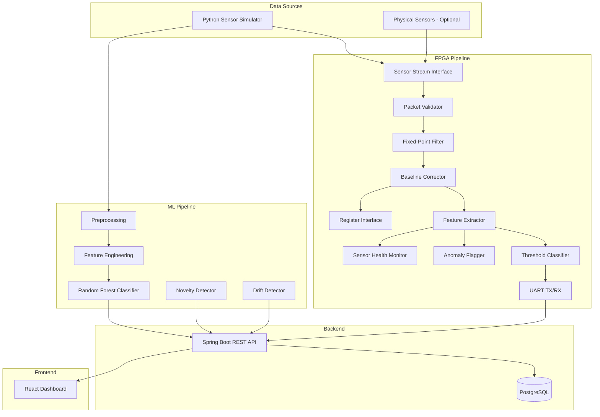
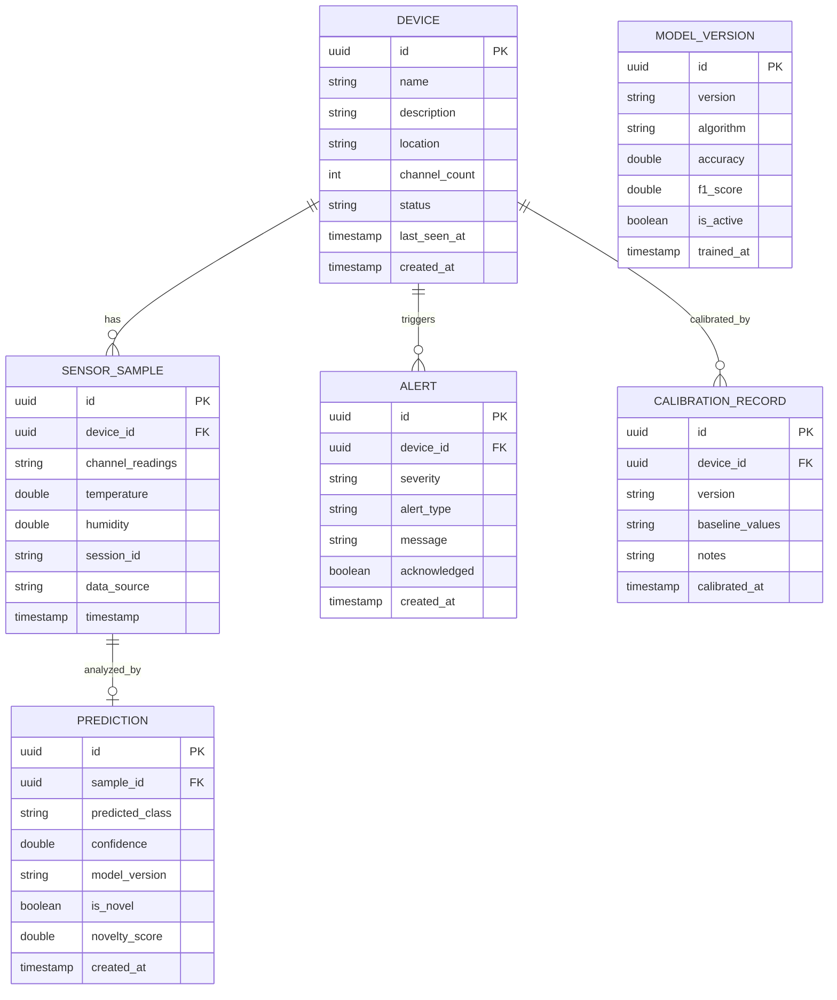

# NeuroNose Architecture Document

## System Overview

NeuroNose is a full-stack electronic nose platform combining FPGA-accelerated signal processing, machine learning classification, and a live monitoring dashboard. The system follows a **simulation-first** methodology — all functionality is verified in simulation before any physical hardware deployment.

## Component Architecture

## Data Flow

### Simulation Mode (Default)
1. `sensor_data_generator.py` creates deterministic synthetic sensor readings
2. Data is fed to either:
   - RTL pipeline via testbench or simulation interface
   - Python ML pipeline directly
3. Results are posted to the Java backend via REST API
4. Frontend polls backend for display

### Hardware Mode (When Available)
1. Physical sensors → ADC → FPGA input pins
2. RTL pipeline processes data in real-time
3. UART transmits packets to host
4. Host software parses packets and forwards to backend
5. Frontend displays live data

## Fixed-Point Format: Q8.8

All RTL arithmetic uses **Q8.8 signed fixed-point**:
- 16 bits total: 1 sign + 7 integer + 8 fractional
- Range: -128.0 to +127.99609375
- Resolution: 1/256 ≈ 0.00390625
- Overflow handling: Saturation (clamp to min/max)

## Register Map

| Address | Name | R/W | Description |
|---------|------|-----|-------------|
| 0x0000 | CTRL | R/W | Control register (enable, reset, mode) |
| 0x0004 | STATUS | R | Status register (health, errors) |
| 0x0008 | SAMPLE_RATE | R/W | Sampling rate divisor |
| 0x000C | FILTER_COEFF | R/W | Filter coefficient (Q8.8) |
| 0x0010-0x002F | BASELINE[0-7] | R/W | Per-channel baselines (Q8.8) |
| 0x0030-0x004F | THRESH_LO[0-7] | R/W | Per-channel low thresholds |
| 0x0050-0x006F | THRESH_HI[0-7] | R/W | Per-channel high thresholds |
| 0x0070-0x00AF | CLASS_THRESH[0-7][0-4] | R/W | Classification thresholds |
| 0x00B0 | HEALTH_FLAGS | R | Channel health flags |
| 0x00B4 | ANOMALY_FLAGS | R | Anomaly detection flags |
| 0x00B8 | SEQ_COUNT | R | Packet sequence counter |
| 0x00BC | ERROR_COUNT | R | Error counter |

## Database Schema (ERD)

## API Design Principles

1. **REST conventions**: Proper HTTP methods and status codes
2. **Pagination**: `page`, `size`, `sort` parameters for list endpoints
3. **Filtering**: Query parameters for date ranges, status, device
4. **Validation**: Bean Validation on all inputs
5. **Error format**: Consistent `{timestamp, status, error, message}` structure
6. **Timestamps**: UTC in storage, ISO 8601 in API responses
7. **CORS**: Configured for development origins only

## Security Model

- Development mode: No authentication required (clearly documented)
- Production mode: Spring Security with BCrypt-hashed passwords (template provided)
- CORS restricted to configured origins
- Environment variables for all secrets
- No secrets in version control
